# BiteFlow — AI-Powered Food Ordering Platform

BiteFlow is a food-ordering application backend with menu browsing, user authentication, cart management, order placement, and an AI-powered food recommendation assistant. The API is built with **Node.js, Express, MongoDB, and Mongoose**, and uses the **Google Generative AI SDK** to generate menu-aware food recommendations.

> **Repository note:** The supplied `BiteFlow-main.zip` contains the backend source code and UI screenshots. It does not contain the frontend application source files. Therefore, this README documents the backend implementation visible in the archive and uses the screenshots only as visual references.

---

## Table of Contents

- [Project Overview](#project-overview)
- [Key Features](#key-features)
- [Technology Stack](#technology-stack)
- [System Architecture](#system-architecture)
- [Application Workflow](#application-workflow)
- [Backend Modules](#backend-modules)
- [Database Design](#database-design)
- [API Documentation](#api-documentation)
- [Project Structure](#project-structure)
- [Installation and Setup](#installation-and-setup)
- [Environment Variables](#environment-variables)
- [Running the Application](#running-the-application)
- [Seeding the Food Menu](#seeding-the-food-menu)
- [Screenshots](#screenshots)
- [Security and Validation Notes](#security-and-validation-notes)
- [Current Limitations](#current-limitations)
- [Future Enhancements](#future-enhancements)

---

## Project Overview

BiteFlow is designed to provide a streamlined food-ordering experience. Users can browse food items, create an account, log in, add products to a cart, update quantities, place orders, and view their order history.

The project also includes an AI food assistant. It retrieves the available food menu from MongoDB and sends that menu together with the user's prompt to a Gemini model. The assistant is instructed to recommend one item that exists in the menu and return a reason and confidence value.

The backend exposes REST API endpoints that a frontend application can call.

## Key Features

### 1. User Authentication
- User registration with name, email, and password.
- Password hashing using `bcryptjs`.
- User login with password verification.
- JSON Web Token (JWT) generation after successful login.
- Protected cart and order routes using authentication middleware.

### 2. Food Menu
- Retrieve all available food items.
- Retrieve a single food item using its MongoDB ID.
- Store food name, description, price, category, image path, and rating.
- Seed the database with sample menu data.

### 3. Shopping Cart
- Add a food item to the authenticated user's cart.
- Increase the quantity when the same food item is added again.
- Retrieve the user's cart with populated food details.
- Update cart-item quantity.
- Remove an item from the cart.

### 4. Order Management
- Place an order using the submitted items and total amount.
- Associate each order with the authenticated user.
- Clear the user's cart after a successful order creation.
- Retrieve the user's previous orders.
- Store an order status, initially set to `Pending`.

### 5. AI Food Recommendation
- Accept a natural-language prompt from the user.
- Retrieve the menu from MongoDB.
- Send the menu and prompt to the configured Gemini model.
- Ask the model to recommend one menu item and explain the recommendation.
- Return the matched food record, recommendation reason, and confidence value.

---

## Technology Stack

| Technology | Purpose |
|---|---|
| Node.js | JavaScript runtime for the backend |
| Express 5 | REST API and route handling |
| MongoDB | Persistent database |
| Mongoose | MongoDB object modelling and queries |
| JavaScript | Backend application logic |
| bcryptjs | Password hashing and comparison |
| JSON Web Token | User authentication |
| Google Generative AI SDK | Gemini-powered food recommendations |
| dotenv | Environment-variable configuration |
| CORS | Cross-origin API access |
| Nodemon | Development server auto-restart |

---

## System Architecture

The backend follows a layered architecture. Requests enter through Express routes, optional authentication middleware verifies protected requests, controllers execute application logic, and Mongoose models communicate with MongoDB. The AI controller additionally calls the Gemini API.

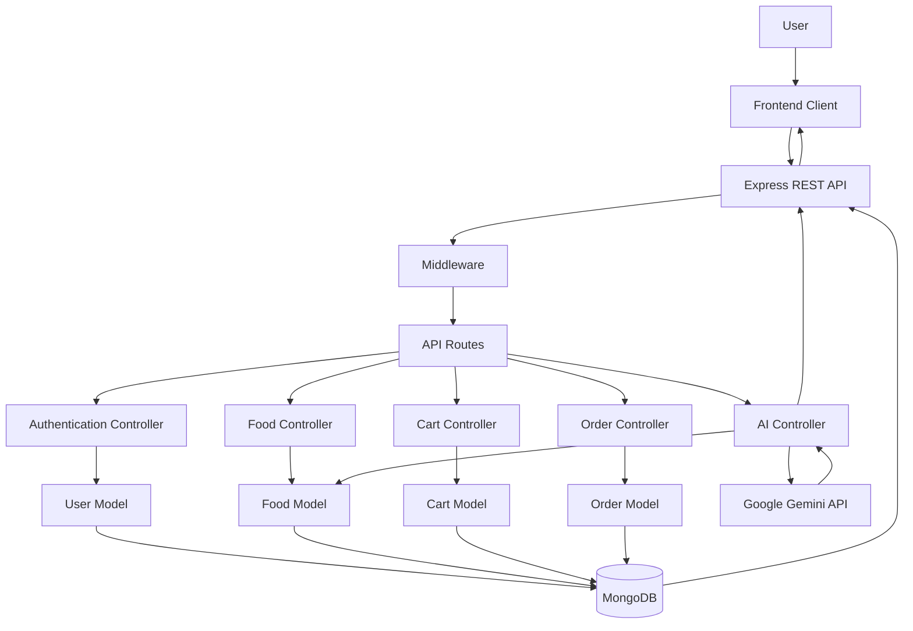

### Architecture Layers

| Layer | Responsibility |
|---|---|
| Client layer | Sends HTTP requests and displays API responses. The frontend source is not included in the supplied archive. |
| Server entry point | `server.js` configures Express, middleware, database connection, and route mounting. |
| Routes layer | Maps API paths and HTTP methods to controller functions. |
| Middleware layer | Verifies JWTs and attaches the authenticated user to the request. |
| Controllers layer | Implements authentication, food, cart, order, and AI operations. |
| Models layer | Defines MongoDB document structures through Mongoose schemas. |
| Database layer | Stores users, food items, cart entries, and orders. |
| External AI service | Gemini generates a menu-based recommendation from the supplied prompt and menu data. |

## Application Workflow

### Overall User Workflow

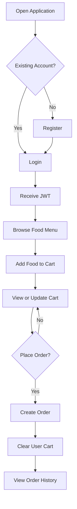

### AI Recommendation Workflow

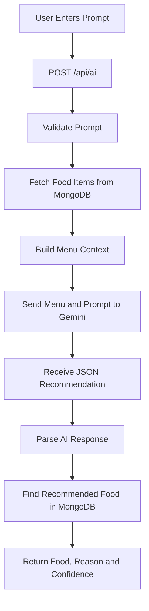

The AI controller's prompt instructs the model to:
- Recommend only food items present in the database menu.
- Recommend one food item.
- Explain why the item was selected.
- Avoid repeating the previous recommendation when the user asks for something different.
- Select a random menu item when the user asks to be surprised.
- Return a confidence value between 80 and 99.
- Return JSON containing `foodName`, `reason`, and `confidence`.

The backend parses the generated JSON and looks up the recommended food by name before returning the response.

---

## Backend Modules

### 1. Server Configuration — `server.js`

The main entry point of the backend.

Responsibilities:
- Loads environment variables using `dotenv`.
- Connects to MongoDB.
- Creates the Express application.
- Enables CORS.
- Enables JSON request-body parsing.
- Mounts authentication, food, cart, order, and AI routes.
- Provides a root API route and a JSON 404 response.
- Starts the server on the configured port, defaulting to `5000`.

### 2. Database Configuration — `config/db.js`

Uses Mongoose to connect to MongoDB with the `MONGO_URI` environment variable. The server logs the connected database host. If the connection fails, the process exits with an error.

### 3. Authentication — `controllers/authController.js`

**Registration**
1. Receives `name`, `email`, and `password`.
2. Checks whether the email already exists.
3. Hashes the password with `bcryptjs` using 10 salt rounds.
4. Creates the user record.
5. Returns the user's ID, name, and email without returning the password.

**Login**
1. Finds the user by email.
2. Compares the submitted password with the stored hash.
3. Signs a JWT containing the user's ID.
4. Sets the token expiry to seven days.
5. Returns the token and basic user details.

### 4. Authentication Middleware — `middleware/authMiddleware.js`

Protected routes use the `protect` middleware.

1. Reads the `Authorization` request header.
2. Extracts the Bearer token.
3. Verifies the token using `JWT_SECRET`.
4. Loads the corresponding user while excluding the password field.
5. Attaches the user to `req.user`.
6. Allows the request to continue.

Requests without a token or with an invalid token receive an HTTP 401 response.

### 5. Food Management — `controllers/foodController.js`

- `getFoods`: retrieves all food documents and returns the count and list.
- `getFoodById`: retrieves one food document using its MongoDB ID and returns 404 if it does not exist.

### 6. Cart Management — `controllers/cartController.js`

- `addToCart`: checks that the food item exists. If the user already has that food in the cart, its quantity is increased; otherwise, a new cart record is created.
- `getCart`: retrieves the authenticated user's cart and populates the referenced food details.
- `updateQuantity`: updates the quantity of a cart record using its ID.
- `removeFromCart`: deletes a cart record using its ID.

### 7. Order Management — `controllers/orderController.js`

- `placeOrder`: creates an order for the authenticated user using the submitted `items` and `totalAmount`, then deletes that user's cart records.
- `getOrders`: retrieves the authenticated user's orders, populates food details in the order items, and sorts the results by newest first.

The order schema defines these statuses: `Pending`, `Preparing`, `Out for Delivery`, and `Delivered`.

### 8. AI Recommendation — `controllers/aiController.js`

The AI controller uses `@google/generative-ai`.

Processing steps:
1. Reads the `prompt` from the request body.
2. Returns HTTP 400 if the prompt is missing.
3. Retrieves all food records from MongoDB.
4. Creates a compact menu containing each food's name, price, description, and category.
5. Sends the menu and conversation prompt to the configured Gemini model.
6. Removes optional Markdown code fences from the model response.
7. Parses the response as JSON.
8. Finds the recommended food in MongoDB by name.
9. Returns the food document, reason, and confidence.

### 9. Database Seeding — `seed/`

- `foodData.js` contains the sample food menu.
- `seedData.js` connects to MongoDB, deletes existing food documents, and inserts the sample menu.

**Important:** Running the seed script replaces the existing food collection contents. Use it carefully if the database contains food records you want to keep.

---

## Database Design

The project defines four Mongoose models.

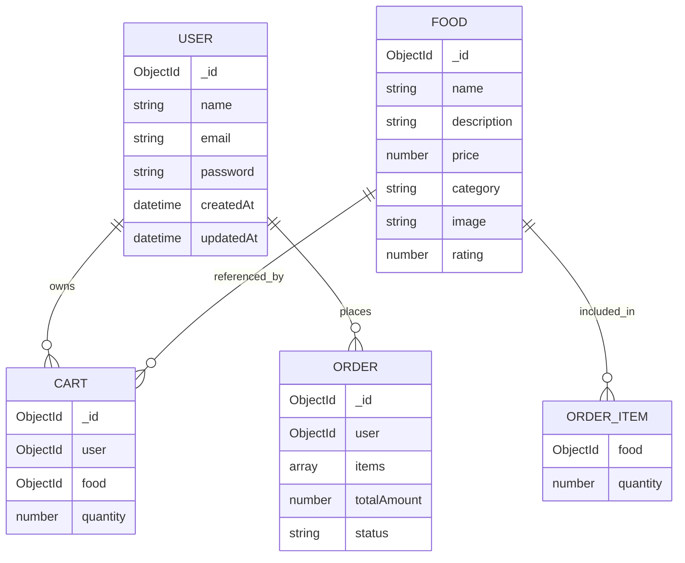

### Model Descriptions

| Model | Important fields | Purpose |
|---|---|---|
| `User` | `name`, `email`, `password` | Stores registered user details. Email is unique. |
| `Food` | `name`, `description`, `price`, `category`, `image`, `rating` | Stores menu items. |
| `Cart` | `user`, `food`, `quantity` | Associates a user with a food item and its selected quantity. |
| `Order` | `user`, `items`, `totalAmount`, `status` | Stores placed orders and their items. |

The `User`, `Food`, `Cart`, and `Order` schemas use timestamps where configured, allowing Mongoose to maintain `createdAt` and `updatedAt` fields.

---

## API Documentation

The backend runs on:

```text
http://localhost:5000
```

All request and response bodies use JSON.

### Base Routes

| Method | Endpoint | Description | Authentication |
|---|---|---|---|
| GET | `/` | API welcome response | No |
| POST | `/api/auth/register` | Register a user | No |
| POST | `/api/auth/login` | Log in a user | No |
| GET | `/api/foods` | Get all food items | No |
| GET | `/api/foods/:id` | Get one food item | No |
| POST | `/api/cart` | Add a food item to cart | Yes |
| GET | `/api/cart` | Get the current user's cart | Yes |
| PATCH | `/api/cart/:id` | Update a cart item's quantity | Yes |
| DELETE | `/api/cart/:id` | Remove a cart item | Yes |
| POST | `/api/orders` | Place an order | Yes |
| GET | `/api/orders` | Get the current user's orders | Yes |
| POST | `/api/ai` | Get an AI food recommendation | No |

For protected endpoints, include the JWT in the request header:

```http
Authorization: Bearer YOUR_JWT_TOKEN
Content-Type: application/json
```

### Authentication API

**Register — `POST /api/auth/register`**

Request:
```json
{
  "name": "Alex",
  "email": "alex@example.com",
  "password": "your-password"
}
```

**Login — `POST /api/auth/login`**

Request:
```json
{
  "email": "alex@example.com",
  "password": "your-password"
}
```

A successful login returns a JWT token and basic user information. Use that token for protected cart and order requests.

### Food API

**Get all foods — `GET /api/foods`**

Returns `success`, `count`, and `foods`.

**Get one food — `GET /api/foods/:id`**

Returns `success` and `food`. If the food document is not found, the API returns HTTP 404.

### Cart API

**Add to cart — `POST /api/cart`**

Request:
```json
{
  "foodId": "MONGODB_FOOD_ID",
  "quantity": 1
}
```

If `quantity` is omitted or evaluates to a falsy value, the controller uses `1`.

**Get cart — `GET /api/cart`**

Returns the authenticated user's cart. Food references are populated with their food-document details.

**Update quantity — `PATCH /api/cart/:id`**

Request:
```json
{
  "quantity": 2
}
```

**Remove item — `DELETE /api/cart/:id`**

The `:id` value is the cart document ID.

### Order API

**Place order — `POST /api/orders`**

Request:
```json
{
  "items": [
    {
      "food": "MONGODB_FOOD_ID",
      "quantity": 2
    }
  ],
  "totalAmount": 598
}
```

The controller creates the order for the authenticated user and clears that user's cart after the order is created.

**Get order history — `GET /api/orders`**

Returns the authenticated user's orders, with food details populated inside order items and newest orders first.

### AI Recommendation API

**Get recommendation — `POST /api/ai`**

Request:
```json
{
  "prompt": "Suggest something spicy for dinner."
}
```

Response shape:
```json
{
  "success": true,
  "recommendation": {
    "_id": "FOOD_DOCUMENT_ID",
    "name": "Example Menu Item",
    "description": "Example description",
    "price": 199,
    "category": "Example Category"
  },
  "reason": "A short explanation for the recommendation.",
  "confidence": 95
}
```

The values above illustrate the response structure; the actual recommendation depends on the menu stored in MongoDB and the model output.

---

## Project Structure

```text
BiteFlow-main/
│
├── screenshots/
│   ├── ai-chat.png
│   ├── ai-recommendation.png
│   ├── banner.png
│   ├── cart.png
│   ├── home.png
│   ├── login.png
│   ├── menu.png
│   ├── orders.png
│   └── register.png
│
└── server/
    ├── config/
    │   └── db.js
    │
    ├── controllers/
    │   ├── aiController.js
    │   ├── authController.js
    │   ├── cartController.js
    │   ├── foodController.js
    │   └── orderController.js
    │
    ├── middleware/
    │   └── authMiddleware.js
    │
    ├── models/
    │   ├── Cart.js
    │   ├── Food.js
    │   ├── Order.js
    │   └── User.js
    │
    ├── routes/
    │   ├── aiRoutes.js
    │   ├── authRoutes.js
    │   ├── cartRoutes.js
    │   ├── foodRoutes.js
    │   └── orderRoutes.js
    │
    ├── seed/
    │   ├── foodData.js
    │   └── seedData.js
    │
    ├── package.json
    ├── package-lock.json
    └── server.js
```

---

## Installation and Setup

### Prerequisites

Install the following before running the backend:

- Node.js (use a current LTS release compatible with the installed dependencies).
- npm.
- MongoDB local installation or a MongoDB Atlas database.
- A Google Gemini API key for the AI recommendation endpoint.

### Step 1: Extract the Project

Extract `BiteFlow-main.zip` and open the project folder in VS Code.

### Step 2: Open the Backend Folder

```bash
cd BiteFlow-main/server
```

### Step 3: Install Dependencies

```bash
npm install
```

### Step 4: Configure Environment Variables

Create a `.env` file inside the `server` directory and add the required values:

```env
PORT=5000
MONGO_URI=mongodb://127.0.0.1:27017/biteflow
JWT_SECRET=replace_with_a_long_random_secret
GEMINI_API_KEY=your_gemini_api_key
```

For MongoDB Atlas, use your Atlas connection string as `MONGO_URI`.

Do not commit the `.env` file or expose API keys and JWT secrets publicly.

### Step 5: Start MongoDB

If you are using a local MongoDB installation, make sure the MongoDB service is running. If you are using MongoDB Atlas, make sure the connection string and network access settings are configured.

---

## Running the Application

### Development Mode

```bash
npm run dev
```

This starts the backend using Nodemon.

### Production Mode

```bash
npm start
```

The server uses port `5000` by default, or the value configured through `PORT`.

When the server starts successfully, open:

```text
http://localhost:5000
```

The root endpoint should return a JSON welcome message.

---

## Seeding the Food Menu

The project includes sample menu data in `seed/foodData.js`.

To import it into MongoDB, run this command from the `server` directory:

```bash
node seed/seedData.js
```

The script deletes existing documents in the `Food` collection and inserts the sample menu. It does not seed users, carts, or orders.

---

## Screenshots

The archive includes the following UI screenshots:

### Home Page
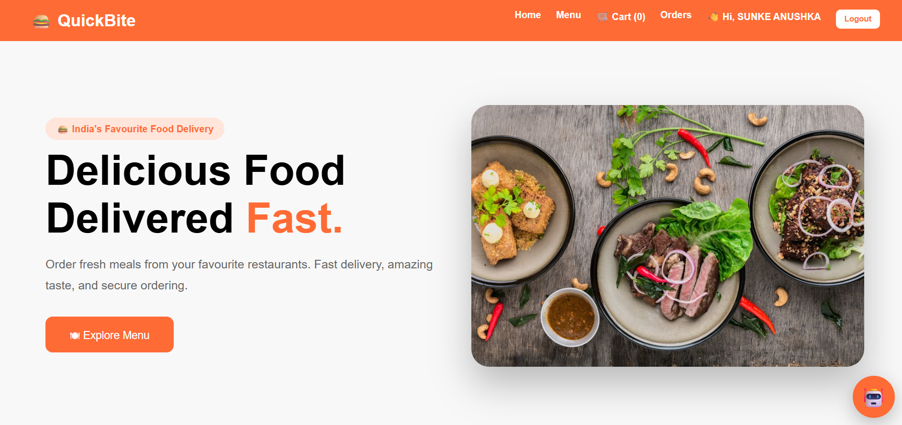

### Food Menu
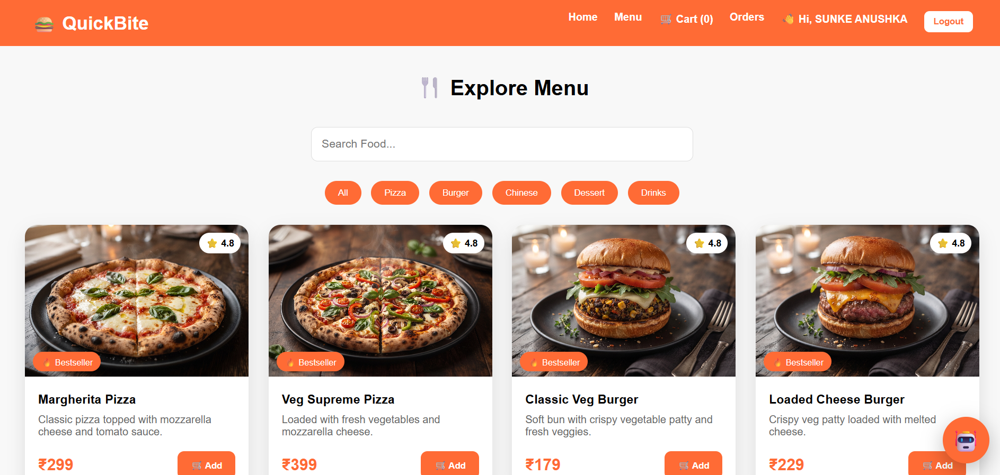

### User Login
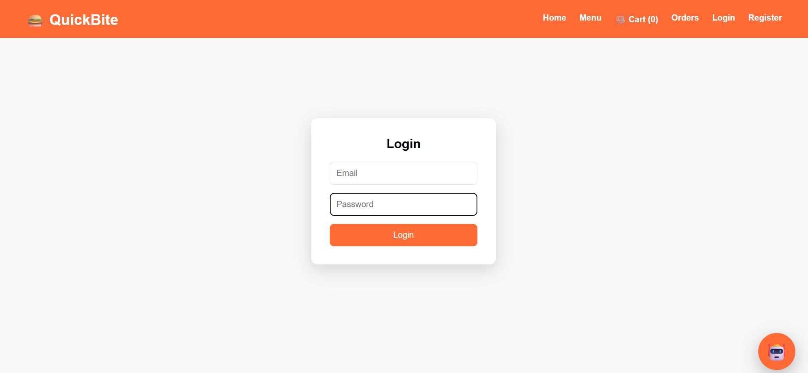

### User Registration
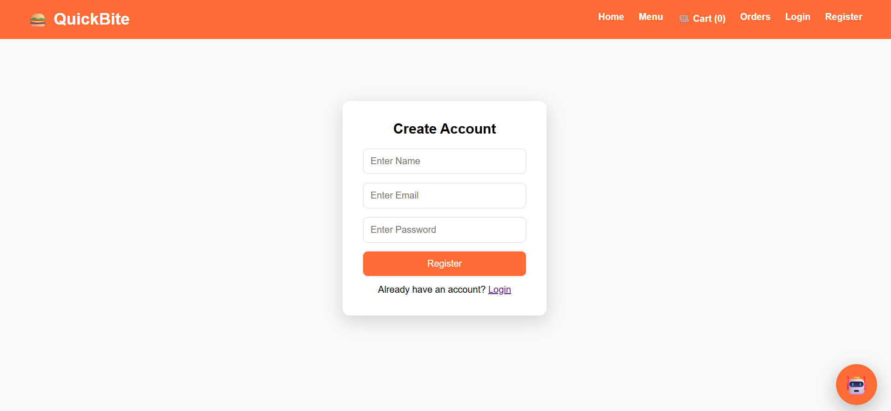

### Shopping Cart
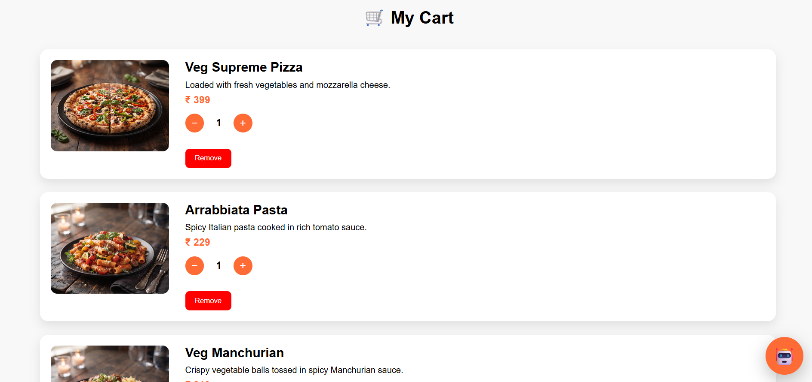

### Orders
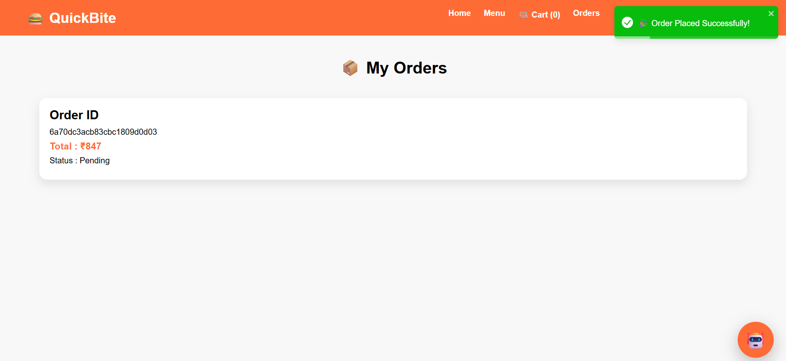

### AI Recommendation
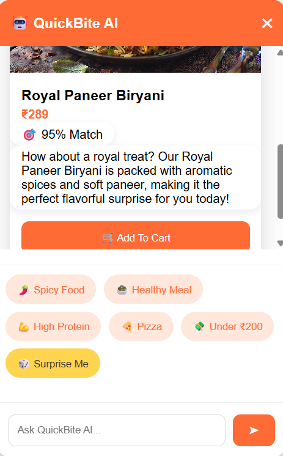

### AI Chat
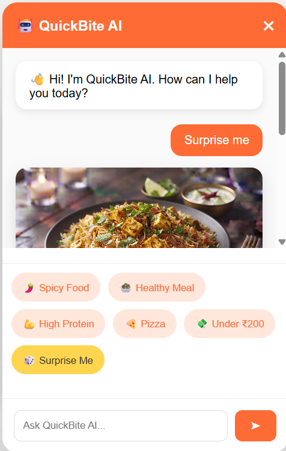

---

## Security and Validation Notes

The following points are worth addressing before using the application with real users:

- Passwords are hashed before storage using `bcryptjs`.
- JWT-protected routes use the `protect` middleware.
- The current cart quantity update and removal controllers locate cart records by cart ID. They should also verify that the record belongs to the authenticated user.
- The order endpoint currently accepts `items` and `totalAmount` from the request body. A production implementation should load prices from the database, calculate the total on the server, and validate every item and quantity.
- Add request validation for required registration fields, email format, password strength, food IDs, quantities, and order payloads.
- Add rate limiting and appropriate error handling to authentication and AI endpoints.
- Validate and constrain AI output before using it. The current implementation parses model-generated JSON and searches for a food item by name; malformed output or a name that does not match a menu record can cause an error or an empty recommendation.
- Restrict CORS to trusted frontend origins in production.
- Keep `.env` and all secrets out of version control.

These are recommendations based on the current backend code, not features already implemented.

---

## Current Limitations

- The supplied archive includes backend code and screenshots, but not the frontend source code.
- The AI recommendation endpoint depends on a valid Gemini API key and external model availability.
- The AI endpoint is not protected by the JWT middleware in the current route configuration.
- The order endpoint does not calculate or verify the submitted total amount on the server.
- Cart update and delete operations should enforce ownership checks.
- No payment gateway integration is present in the supplied backend.
- No delivery partner tracking or live order tracking implementation is present in the supplied backend.
- No automated test suite is included in the supplied archive.

---

## Future Enhancements

- Add server-side cart and order validation.
- Enforce ownership checks for every cart operation.
- Add payment gateway integration.
- Add order status update endpoints and an admin interface.
- Add delivery status tracking.
- Add food search, filtering, and sorting.
- Improve AI recommendations with user preferences, dietary requirements, and order history.
- Add conversation context management for multi-turn AI recommendations.
- Add API tests and integration tests.
- Add centralized logging, request validation, and production monitoring.
- Include the frontend source code and document its setup separately.

---

## License

The supplied `server/package.json` declares the package license as `ISC`. Confirm the intended project-wide license and add a root-level `LICENSE` file before distributing the complete project.

---

**BiteFlow — Browse food, order with ease, and discover your next meal with AI.**
